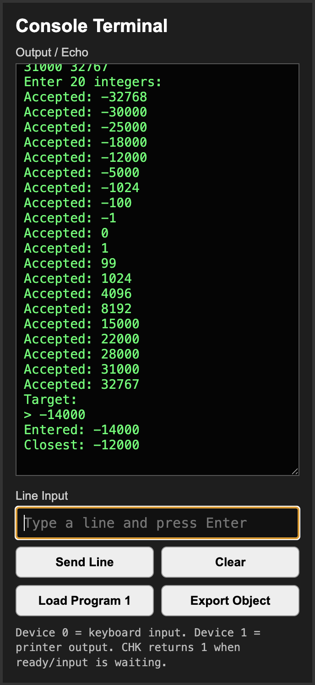
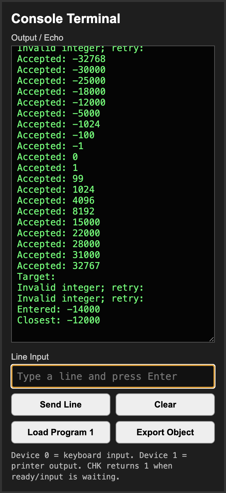
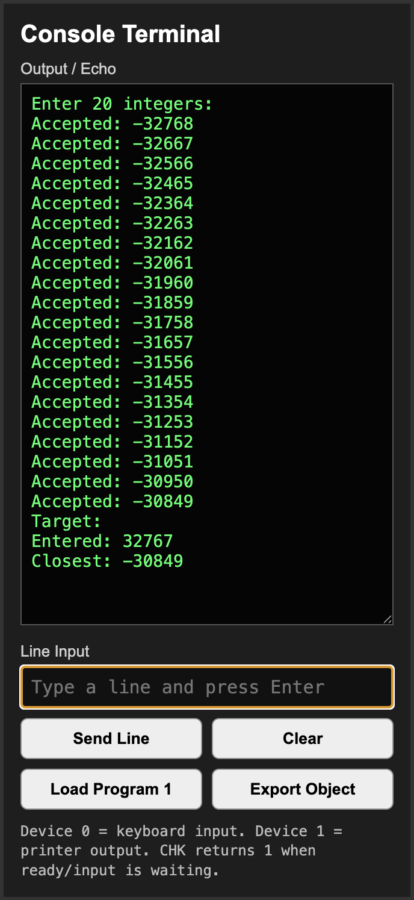
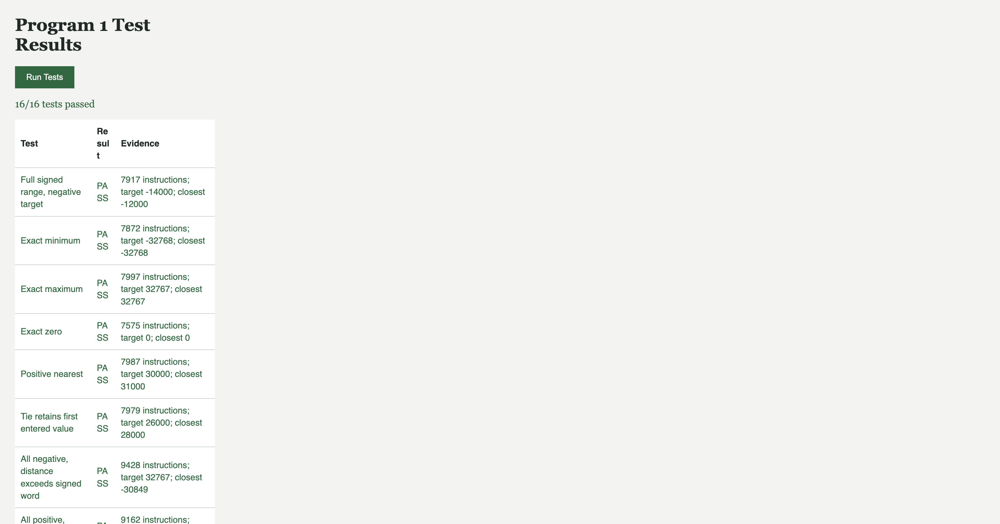

# Program 1 Delivery

## Deadline

The due date has been extended by **1 week and 1 day (8 days)**. No original
deadline was supplied, so no calendar date is invented.

## Run

Open [Machine_Simulator.html](Machine_Simulator.html), select **Load Program 1**,
then **Run**. Type numbers in Line Input and press Enter or Send Line. Numbers can
share a line or arrive one per line. After exactly 20 valid integers, the printer
requests `Target:`. Enter the target; execution ends at HLT after printing the result.
Use Load Program 1 to start another run. SS executes one instruction at a time.

Alternatively, Init loads [programs/Program1.obj.txt](programs/Program1.obj.txt).
Set the editable PC field to octal `0400`, then Run. The adjacent LD button copies
the front-panel switches, so it is not needed after typing PC directly.

Keep the directory structure intact. The simulator uses local JavaScript files;
opening the HTML directly is sufficient, with no server or packages.

## Implementation

[programs/Program1.js](programs/Program1.js) is a small label-resolving assembly
builder. Its `build()` returns the instruction listing, labels, memory image,
and octal object text. JavaScript assembles the instructions but does not parse
the user's integers or calculate the closest value during ordinary execution.
Those operations use IN, OUT, LDR/STR, arithmetic, branches, MLT, DVD, and subroutines
inside the simulated CPU, including its existing write-back cache.

- Entry: decimal 256 / octal `0400`; 562 instructions, 622 object words including data and branch tables.
- Constants/variables: decimal 64..92. IX1 addresses that data bank.
- Indirect branch table: starts at decimal 128; IX2 and IX3 address its two banks.
- Input array: decimal 1800..1819, holding signed two's-complement words.
- Decimal print buffer: decimal 1840..1844.
- Reader consumes characters, checks ASCII digits, subtracts ASCII zero, and assembles the value using multiply-by-ten and subtraction.
- Negative accumulation permits `-32768` without an overflowing positive intermediate. A pre-multiply check rejects values outside `-32768..32767`.
- Optional leading `+`/`-`, leading zeros, space, tab, CR, and LF are accepted. Invalid whole tokens are discarded through the next delimiter and do not count toward 20.
- Search handles distances from 0 through 65535 as unsigned words. It does not mistake a wrapped signed difference for a short distance. Ties retain the first entered value.
- Decimal output uses negative quotient/remainder conversion, including the minimum signed integer.

The simulator's empty IN behavior was corrected to retry the same instruction
without changing the destination register. Run remains active while waiting and
resumes when input arrives. Run executes up to 200 instructions per timer tick;
SS and cache rendering remain available. Existing user changes were preserved.

## Samples

### Sample A: Distributed Signed Values

Enter these 20 values:

```text
-32768 -30000 -25000 -18000 -12000 -5000 -1024 -100 -1 0
1 99 1024 4096 8192 15000 22000 28000 31000 32767
```

Enter target `-14000`. The printer echoes every accepted integer and finishes:

```text
Target:
Entered: -14000
Closest: -12000
```

This run was also completed through the visible Run button and keyboard Enter
events. MFR was `0000`, HLT was on, and Run stopped.



### Sample B: Invalid Tokens

Before Sample A's values, send:

```text
abc 12x --2 + - 32768 -32769 999999999999 3.5
```

At the target prompt, send `32768 bad -14000`. There are 11 rejection messages
in total; all 20 accepted values remain unchanged and the result is still `-12000`.
The screenshot shows the final printer portion; earlier lines remain in the
scrollable output and are checked by the automated test.



### Sample C: Distance Beyond 32767

```text
-32768 -32667 -32566 -32465 -32364 -32263 -32162 -32061 -31960 -31859
-31758 -31657 -31556 -31455 -31354 -31253 -31152 -31051 -30950 -30849
```

Target `32767` produces `Closest: -30849`, a distance of 63616. This verifies
that the search does not overflow a signed 16-bit distance.



## Verification

Open [test/PROGRAM1_TEST_HARNESS.html](test/PROGRAM1_TEST_HARNESS.html) and select
Run Tests. It runs against the actual simulator in an iframe. Unlike the older
cache-only harness, this full-program harness resets the machine and leaves the
last test state visible; use it separately from an in-progress interactive run.

Observed result on 2026-10-16: **16/16 test groups passed**, including 60 deterministic
full-range machine runs compared to an independent JavaScript nearest-value oracle,
plus all 14 cache regression tests. Coverage includes both endpoints, exact matches,
zero, positive/negative targets, ties, duplicate values, signed zero, formatting,
malformed tokens, range rejection, and waiting before the twentieth value or target.
Tests verify the 20 stored memory words as well as the printer output.



Desktop layout was checked at 1600px and mobile layout at 390px, with no page-wide
horizontal overflow at mobile size. The cache table has its own horizontal scroller.
[Mobile screenshot](test/evidence/program1-mobile.png).

The editor reported no errors in the changed HTML and JavaScript files. The object
image was generated with macOS JavaScriptCore because Node.js is not installed.
The browser's export control is provided, but its download could not be verified
through the integrated browser; the generated object file is included directly.

## GitHub Evidence

[GITHUB_SUBMISSION_LOG.md](GITHUB_SUBMISSION_LOG.md) is preserved exactly as it was
before Program 1 work, including its original participation entries.

Program 1 work is recorded separately in focused local commits:

| Commit | Change |
| --- | --- |
| `3f3bffd` | Fix keyboard input waiting and batch CPU execution |
| `8eca335` | Add signed nearest-number machine program and loader |
| `4858da5` | Add Program 1 regression tests and screenshot evidence |

The delivery guide and README are committed separately from implementation and
tests. No push has been performed. The pre-existing simulator formatting changes
and modified Part 1 ZIP are left uncommitted and unchanged by this commit split.